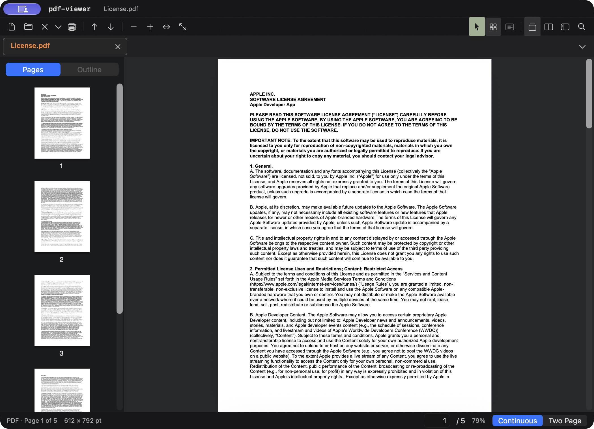
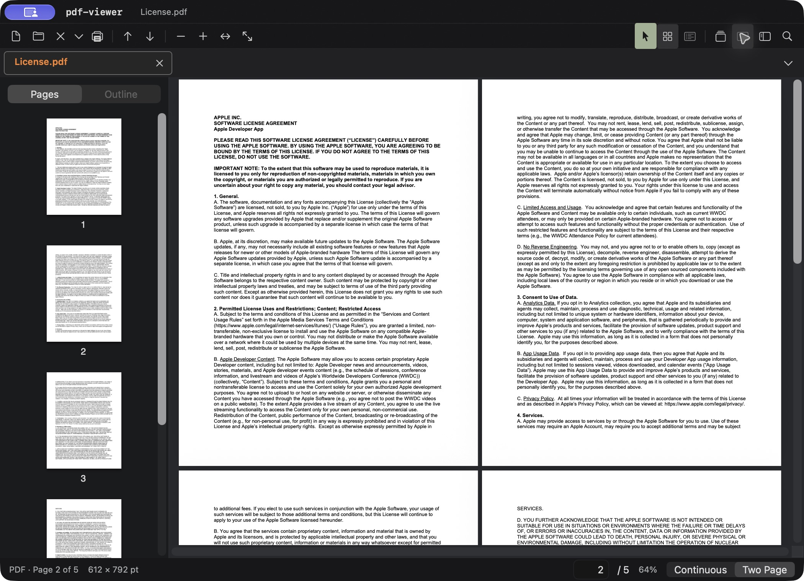

# pdf-viewer

**Version 0.1** · macOS 13 or later · PDF and DjVu viewer

`pdf-viewer` is a native macOS reader written in Swift with AppKit and PDFKit. DjVu pages are decoded with the bundled DjVuLibre library. The interface is in English.

## Screenshots

Both screenshots show `License.pdf` in pdf-viewer. The sample PDF is not included in this repository.

### Reading view

[](docs/pdf-reading.jpg)

### Two-page view

[](docs/pdf-two-page.jpg)

## Features in 0.1

- Open PDF, DjVu, and DjV files from the File menu, Finder, command line, or drag and drop.
- Keep multiple documents in tabs. Use the menu at the right of the tab strip to switch to a tab that does not fit on screen.
- Navigate with page numbers, thumbnails, and document outlines. DjVu bookmarks are supported.
- Search PDF text with highlighted matches. Search a DjVu hidden text layer by page when one is available.
- Read in continuous or two-page mode; zoom, fit the page, or fit the width.
- Select text, follow links, and print PDF files. Open password-protected PDFs.

Version 0.1 is a viewer and does not save changes to PDF files. PDF editing is planned for a later version.

## Build and run

Install Xcode with its Swift toolchain and the standard C/C++ build tools. From the `pdf-viewer` directory, run:

```sh
./build-app.sh
open dist/pdf-viewer.app
```

The first build compiles the vendored DjVuLibre 3.5.30 source as a static library. The script produces an optimized, locally signed app at `dist/pdf-viewer.app`. It does not require Homebrew, Qt, or .NET at runtime. Public distribution requires an Apple Developer signature and notarization.

## Keyboard shortcuts

| Action | Shortcut |
| --- | --- |
| Open a file | Command-O |
| New window | Command-N |
| Close tab | Command-W |
| Find | Command-F |
| Next / previous tab | Control-Tab / Control-Shift-Tab |
| Fit width / page | Command-1 / Command-2 |

## Source and license

This macOS viewer was developed with the Windows [KillerPDF 1.9.1](../KillerPDF-1.9.1/) and [DjView4 4.12](../djvu/djview4-4.12/) source trees as references. It uses native Swift UI rather than their WPF or Qt interfaces. The app is licensed under [GPLv3](LICENSE). Bundled DjVuLibre is GPL-2.0-or-later; its license is copied into the app bundle during the build.
